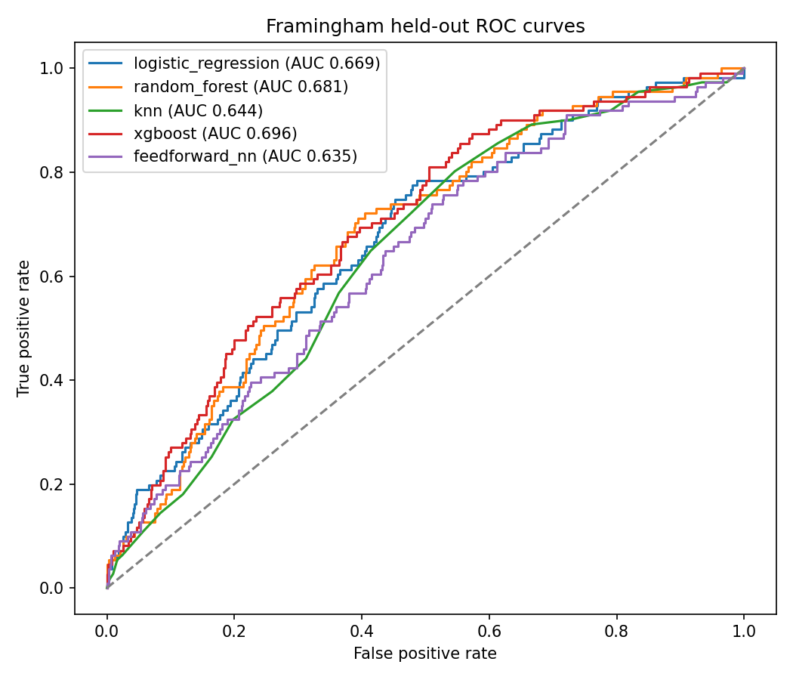
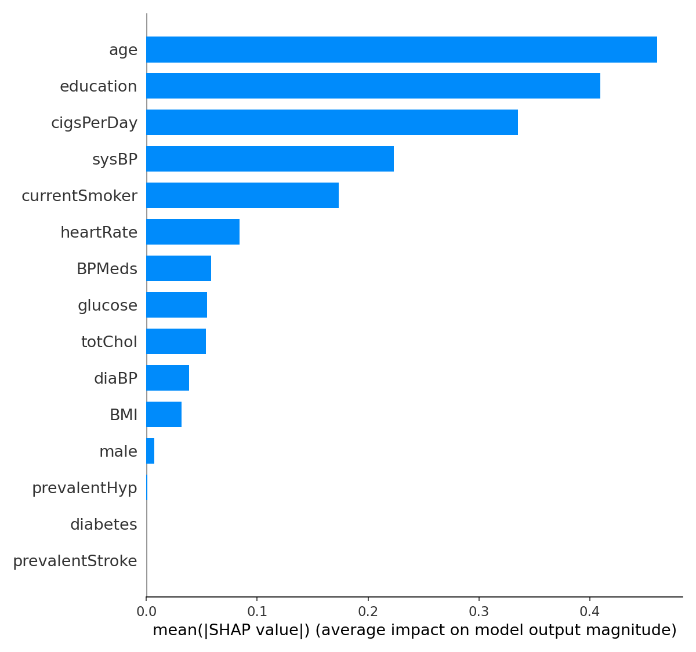
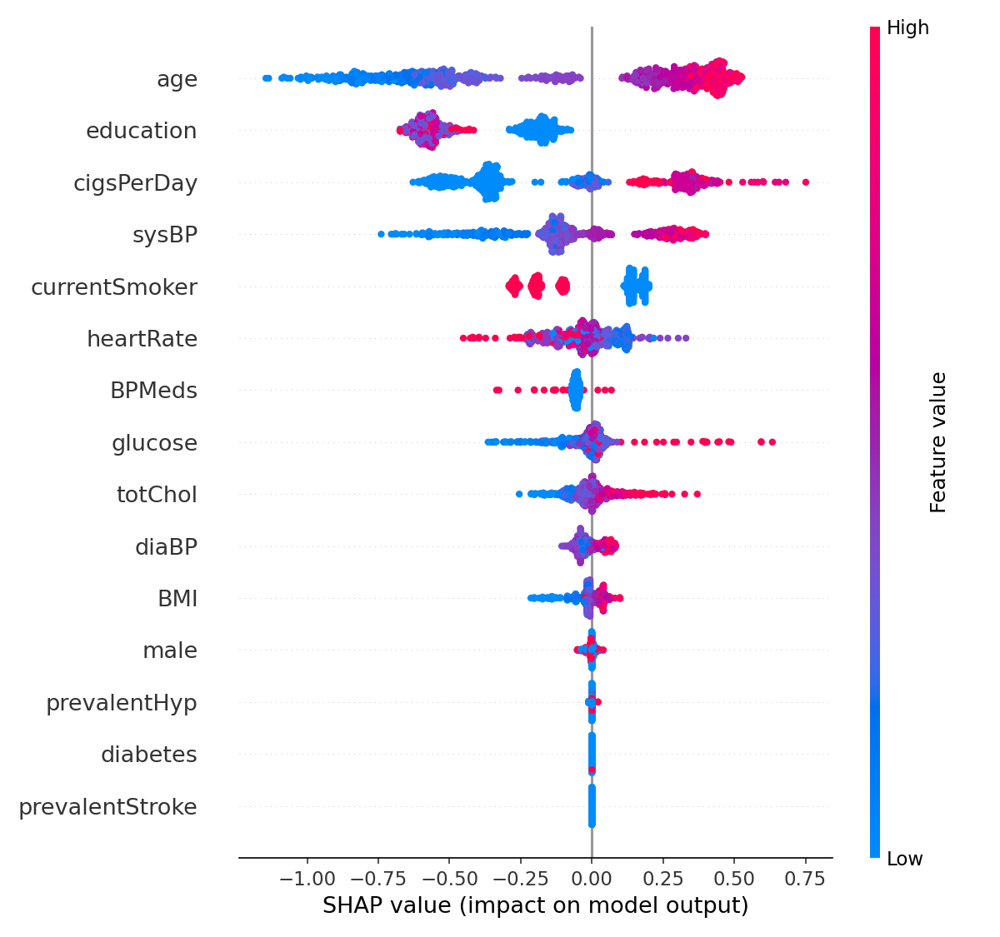
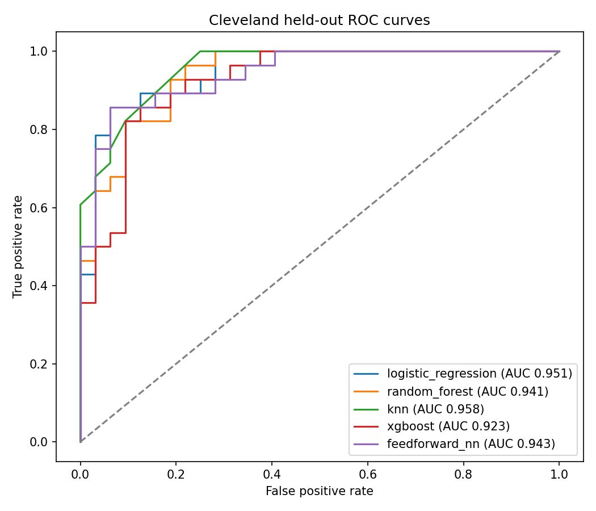
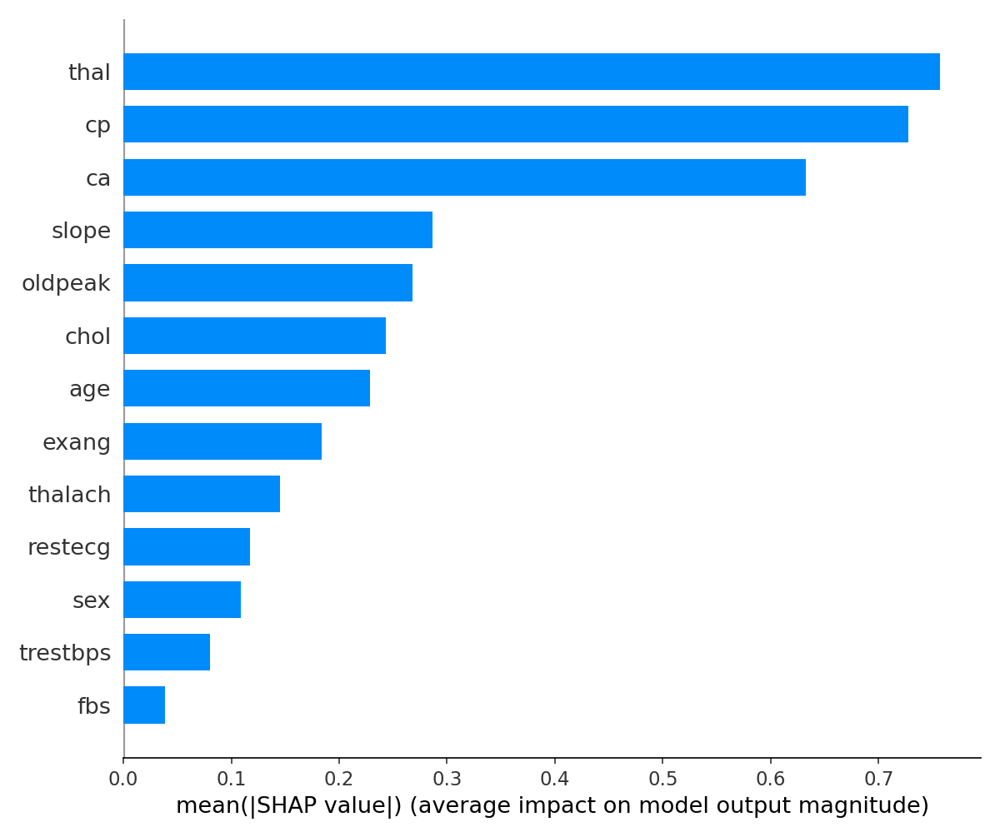
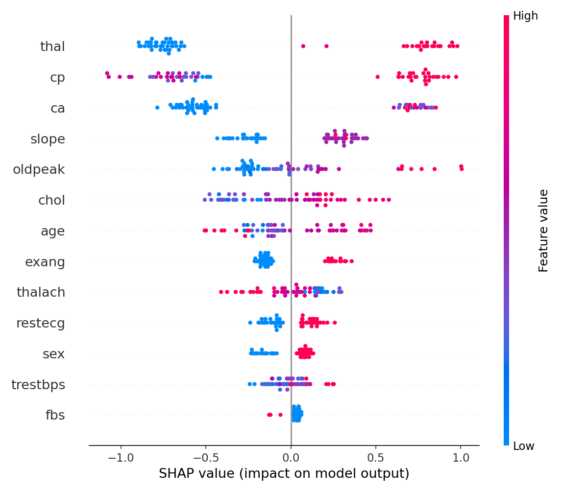

# Raman et al. (2026) CHD reproduction

This report reproduces [Raman et al. (2026)](https://pmc.ncbi.nlm.nih.gov/articles/PMC13298444/), DOI [10.3390/epidemiologia7030075](https://doi.org/10.3390/epidemiologia7030075), and is generated by `python -m raman2026_chd`. Raw datasets are fetched from the URLs and verified against SHA-256 values in `raman2026_chd/download_data.py`.

## Methods, assumptions, and deviations

- Random seed: `42`; stratified holdout: `20%`; tuning: 5-fold CV scored by `roc_auc`.
- Each split's seed is also used for SMOTE, random undersampling, and stochastic classifiers. The repeated-split seeds start at `42` for Framingham and `1042` for Cleveland.
- SMOTE uses `1.0` then random undersampling uses `1.0`; scaling is fitted after training-fold resampling. The held-out test data is only transformed, never resampled.
- Decision threshold: `0.5`. Neural net uses hidden layers [64, 32], dropout 0.2, Adam, batch size 512, a maximum of 25 epochs, patience 5, and 1 CPU thread; early stopping monitors training loss (no validation set).
- Repeated splits use the published fixed hyperparameters (no per-split retuning, to keep the CPU analysis practical); ranking intervals are empirical 2.5th–97.5th percentiles across splits. Bootstrap CIs use 1,000 stratified resamples of held-out test patients.
- Published tuning ranges are not reported by the paper. We use the explicit, compact search spaces in `config.json` and ROC AUC as the CV scoring measure.
- The source Framingham CSV has 16 columns including the outcome; analysis checks complete cases and removes duplicates. Cleveland `?` values are removed and disease is `num > 0`.
- Dependency versions are pinned in `requirements.txt`; the PyTorch CPU wheel is used for the laptop workflow.
- The paper reports PyTorch 2.12.0; this reproduction pins the CPU build of PyTorch 2.9.1, a documented library-version deviation.

## Cleaning and holdout counts

| Dataset | Clean rows (paper) | Train (paper) | Test (paper) | Train positive rate | Test positive rate |
|---|---:|---:|---:|---:|---:|
| Framingham | 3658 (3658) | 2926 (2926) | 732 (732) | 0.152 | 0.152 |
| Cleveland | 297 (297) | 237 (237) | 60 (60) | 0.460 | 0.467 |

## Single-split metrics versus paper

### Framingham

| Model | Metric | Reproduced (bootstrap 95% CI) | Published | Delta |
|---|---|---:|---:|---:|
| logistic_regression | accuracy | 0.6516 [0.6161, 0.6831] | 0.6803 | -0.0287 |
| logistic_regression | precision | 0.2353 [0.2000, 0.2691] | 0.2764 | -0.0411 |
| logistic_regression | recall | 0.5766 [0.4775, 0.6667] | 0.6847 | -0.1081 |
| logistic_regression | f1 | 0.3342 [0.2827, 0.3834] | 0.3938 | -0.0596 |
| logistic_regression | mcc | 0.1793 [0.1018, 0.2532] | 0.2698 | -0.0905 |
| logistic_regression | auroc | 0.6694 [0.6145, 0.7245] | 0.7234 | -0.0540 |
| logistic_regression | brier | 0.2220 [0.2135, 0.2309] | 0.2138 | +0.0082 |
| random_forest | accuracy | 0.7568 [0.7268, 0.7842] | 0.7391 | +0.0177 |
| random_forest | precision | 0.2781 [0.2176, 0.3359] | 0.2872 | -0.0091 |
| random_forest | recall | 0.3784 [0.2883, 0.4685] | 0.4865 | -0.1081 |
| random_forest | f1 | 0.3206 [0.2519, 0.3881] | 0.3612 | -0.0406 |
| random_forest | mcc | 0.1798 [0.0962, 0.2617] | 0.2222 | -0.0424 |
| random_forest | auroc | 0.6810 [0.6281, 0.7319] | 0.6929 | -0.0119 |
| random_forest | brier | 0.1704 [0.1610, 0.1799] | 0.1750 | -0.0046 |
| knn | accuracy | 0.6503 [0.6148, 0.6831] | 0.6489 | +0.0014 |
| knn | precision | 0.2016 [0.1623, 0.2392] | 0.2448 | -0.0432 |
| knn | recall | 0.4414 [0.3511, 0.5227] | 0.6306 | -0.1892 |
| knn | f1 | 0.2768 [0.2234, 0.3278] | 0.3526 | -0.0758 |
| knn | mcc | 0.0983 [0.0217, 0.1708] | 0.2079 | -0.1096 |
| knn | auroc | 0.6437 [0.5909, 0.6962] | 0.6741 | -0.0304 |
| knn | brier | 0.2079 [0.1941, 0.2222] | 0.2271 | -0.0192 |
| xgboost | accuracy | 0.7828 [0.7555, 0.8087] | 0.6899 | +0.0929 |
| xgboost | precision | 0.2895 [0.2222, 0.3651] | 0.2456 | +0.0439 |
| xgboost | recall | 0.2973 [0.2162, 0.3874] | 0.5045 | -0.2072 |
| xgboost | f1 | 0.2933 [0.2201, 0.3689] | 0.3304 | -0.0371 |
| xgboost | mcc | 0.1651 [0.0848, 0.2546] | 0.1762 | -0.0111 |
| xgboost | auroc | 0.6964 [0.6405, 0.7469] | 0.6882 | +0.0082 |
| xgboost | brier | 0.1554 [0.1465, 0.1646] | 0.2255 | -0.0701 |
| feedforward_nn | accuracy | 0.6503 [0.6161, 0.6845] | 0.7719 | -0.1216 |
| feedforward_nn | precision | 0.2157 [0.1777, 0.2533] | 0.2812 | -0.0655 |
| feedforward_nn | recall | 0.4955 [0.4054, 0.5856] | 0.3243 | +0.1712 |
| feedforward_nn | f1 | 0.3005 [0.2486, 0.3533] | 0.3013 | -0.0008 |
| feedforward_nn | mcc | 0.1306 [0.0544, 0.2077] | 0.1664 | -0.0358 |
| feedforward_nn | auroc | 0.6353 [0.5792, 0.6866] | 0.6625 | -0.0272 |
| feedforward_nn | brier | 0.2102 [0.1964, 0.2245] | 0.2048 | +0.0054 |

Single-split configurations (the classical models use the CV-selected parameters unless `--skip-tuning` was used):

- logistic_regression: `{"classifier__C": 0.001}`
- random_forest: `{"classifier__criterion": "gini", "classifier__max_depth": 8, "classifier__max_features": "sqrt", "classifier__n_estimators": 75}`
- knn: `{"classifier__metric": "manhattan", "classifier__n_neighbors": 25, "classifier__weights": "uniform"}`
- xgboost: `{"classifier__colsample_bytree": 0.5, "classifier__learning_rate": 0.1, "classifier__max_depth": 3, "classifier__min_child_weight": 3, "classifier__n_estimators": 50, "classifier__subsample": 0.8}`
- feedforward_nn: `{"hidden_layers": [64, 32]}`

Paper's expected XGBoost SHAP features: sysBP, currentSmoker, prevalentHyp. Reproduced top features: age, education, cigsPerDay, sysBP, currentSmoker, heartRate, BPMeds, glucose, totChol, diaBP.

### Cleveland

| Model | Metric | Reproduced (bootstrap 95% CI) | Published | Delta |
|---|---|---:|---:|---:|
| logistic_regression | accuracy | 0.9000 [0.8167, 0.9667] | 0.8667 | +0.0333 |
| logistic_regression | precision | 0.9231 [0.8214, 1.0000] | 0.8571 | +0.0660 |
| logistic_regression | recall | 0.8571 [0.7143, 0.9643] | 0.8571 | +0.0000 |
| logistic_regression | f1 | 0.8889 [0.8000, 0.9643] | 0.8571 | +0.0318 |
| logistic_regression | mcc | 0.8000 [0.6367, 0.9349] | 0.7321 | +0.0679 |
| logistic_regression | auroc | 0.9509 [0.8939, 0.9900] | 0.9475 | +0.0034 |
| logistic_regression | brier | 0.2084 [0.1998, 0.2170] | 0.2096 | -0.0012 |
| random_forest | accuracy | 0.8500 [0.7500, 0.9333] | 0.8333 | +0.0167 |
| random_forest | precision | 0.8519 [0.7352, 0.9615] | 0.8462 | +0.0057 |
| random_forest | recall | 0.8214 [0.6429, 0.9643] | 0.7857 | +0.0357 |
| random_forest | f1 | 0.8364 [0.7200, 0.9259] | 0.8148 | +0.0216 |
| random_forest | mcc | 0.6984 [0.4992, 0.8674] | 0.6652 | +0.0332 |
| random_forest | auroc | 0.9408 [0.8761, 0.9822] | 0.9275 | +0.0133 |
| random_forest | brier | 0.1059 [0.0719, 0.1477] | 0.1122 | -0.0063 |
| knn | accuracy | 0.8500 [0.7500, 0.9333] | 0.8333 | +0.0167 |
| knn | precision | 0.9130 [0.7917, 1.0000] | 0.8462 | +0.0668 |
| knn | recall | 0.7500 [0.5714, 0.8929] | 0.7857 | -0.0357 |
| knn | f1 | 0.8235 [0.6939, 0.9259] | 0.8148 | +0.0087 |
| knn | mcc | 0.7054 [0.5123, 0.8729] | 0.6652 | +0.0402 |
| knn | auroc | 0.9581 [0.9101, 0.9900] | 0.9531 | +0.0050 |
| knn | brier | 0.0916 [0.0570, 0.1303] | 0.0942 | -0.0026 |
| xgboost | accuracy | 0.8500 [0.7500, 0.9333] | 0.8333 | +0.0167 |
| xgboost | precision | 0.8800 [0.7600, 1.0000] | 0.8750 | +0.0050 |
| xgboost | recall | 0.7857 [0.6071, 0.9286] | 0.7500 | +0.0357 |
| xgboost | f1 | 0.8302 [0.7083, 0.9286] | 0.8077 | +0.0225 |
| xgboost | mcc | 0.7002 [0.4993, 0.8674] | 0.6683 | +0.0319 |
| xgboost | auroc | 0.9230 [0.8471, 0.9766] | 0.9364 | -0.0134 |
| xgboost | brier | 0.1176 [0.0713, 0.1726] | 0.1087 | +0.0089 |
| feedforward_nn | accuracy | 0.8667 [0.7829, 0.9500] | 0.8500 | +0.0167 |
| feedforward_nn | precision | 0.8571 [0.7428, 0.9630] | 0.8276 | +0.0295 |
| feedforward_nn | recall | 0.8571 [0.7143, 0.9643] | 0.8571 | +0.0000 |
| feedforward_nn | f1 | 0.8571 [0.7586, 0.9455] | 0.8421 | +0.0150 |
| feedforward_nn | mcc | 0.7321 [0.5635, 0.9003] | 0.6997 | +0.0324 |
| feedforward_nn | auroc | 0.9431 [0.8806, 0.9877] | 0.8867 | +0.0564 |
| feedforward_nn | brier | 0.1632 [0.1446, 0.1832] | 0.1360 | +0.0272 |

Single-split configurations (the classical models use the CV-selected parameters unless `--skip-tuning` was used):

- logistic_regression: `{"classifier__C": 0.001}`
- random_forest: `{"classifier__criterion": "gini", "classifier__max_depth": 8, "classifier__max_features": "sqrt", "classifier__n_estimators": 200}`
- knn: `{"classifier__metric": "manhattan", "classifier__n_neighbors": 15, "classifier__weights": "uniform"}`
- xgboost: `{"classifier__colsample_bytree": 0.5, "classifier__learning_rate": 0.1, "classifier__max_depth": 3, "classifier__min_child_weight": 1, "classifier__n_estimators": 50, "classifier__subsample": 0.5}`
- feedforward_nn: `{"hidden_layers": [64, 32]}`

Paper's expected XGBoost SHAP features: ca, cp, thal, age. Reproduced top features: thal, cp, ca, slope, oldpeak, chol, age, exang, thalach, restecg.

## Repeated-split robustness

100 stratified 80/20 holdout splits per dataset; the published hyperparameters are fixed for every split.

### Framingham

| Model | Metric | Mean | SD | Empirical 95% interval |
|---|---|---:|---:|---:|
| feedforward_nn | accuracy | 0.6662 | 0.0181 | [0.6373, 0.6995] |
| feedforward_nn | precision | 0.2391 | 0.0175 | [0.2101, 0.2818] |
| feedforward_nn | recall | 0.5500 | 0.0514 | [0.4685, 0.6401] |
| feedforward_nn | f1 | 0.3330 | 0.0244 | [0.2905, 0.3922] |
| feedforward_nn | mcc | 0.1785 | 0.0355 | [0.1172, 0.2633] |
| feedforward_nn | auroc | 0.6670 | 0.0238 | [0.6226, 0.7117] |
| feedforward_nn | brier | 0.2058 | 0.0067 | [0.1931, 0.2162] |
| knn | accuracy | 0.6606 | 0.0165 | [0.6325, 0.6954] |
| knn | precision | 0.2196 | 0.0164 | [0.1910, 0.2505] |
| knn | recall | 0.4841 | 0.0414 | [0.4054, 0.5723] |
| knn | f1 | 0.3019 | 0.0222 | [0.2607, 0.3435] |
| knn | mcc | 0.1341 | 0.0318 | [0.0764, 0.1934] |
| knn | auroc | 0.6306 | 0.0222 | [0.5884, 0.6685] |
| knn | brier | 0.2145 | 0.0077 | [0.2014, 0.2301] |
| logistic_regression | accuracy | 0.6648 | 0.0163 | [0.6393, 0.6982] |
| logistic_regression | precision | 0.2505 | 0.0168 | [0.2243, 0.2868] |
| logistic_regression | recall | 0.6071 | 0.0453 | [0.5225, 0.6851] |
| logistic_regression | f1 | 0.3545 | 0.0233 | [0.3152, 0.4007] |
| logistic_regression | mcc | 0.2101 | 0.0348 | [0.1519, 0.2773] |
| logistic_regression | auroc | 0.6881 | 0.0237 | [0.6452, 0.7338] |
| logistic_regression | brier | 0.2127 | 0.0055 | [0.2021, 0.2211] |
| random_forest | accuracy | 0.7483 | 0.0168 | [0.7110, 0.7761] |
| random_forest | precision | 0.2725 | 0.0256 | [0.2196, 0.3198] |
| random_forest | recall | 0.3930 | 0.0458 | [0.3106, 0.4732] |
| random_forest | f1 | 0.3211 | 0.0295 | [0.2647, 0.3758] |
| random_forest | mcc | 0.1779 | 0.0366 | [0.1035, 0.2456] |
| random_forest | auroc | 0.6815 | 0.0223 | [0.6352, 0.7221] |
| random_forest | brier | 0.1720 | 0.0046 | [0.1644, 0.1812] |
| xgboost | accuracy | 0.7263 | 0.0275 | [0.6643, 0.7719] |
| xgboost | precision | 0.2767 | 0.0257 | [0.2268, 0.3232] |
| xgboost | recall | 0.4908 | 0.0541 | [0.3784, 0.5766] |
| xgboost | f1 | 0.3525 | 0.0272 | [0.3046, 0.3994] |
| xgboost | mcc | 0.2103 | 0.0361 | [0.1425, 0.2722] |
| xgboost | auroc | 0.6958 | 0.0226 | [0.6511, 0.7404] |
| xgboost | brier | 0.2227 | 0.0019 | [0.2189, 0.2258] |

Ranked first (ties count for each model):

- accuracy: random_forest 82.0%, xgboost 18.0%
- precision: feedforward_nn 4.0%, knn 1.0%, logistic_regression 7.0%, random_forest 39.0%, xgboost 49.0%
- recall: feedforward_nn 8.0%, logistic_regression 96.0%, xgboost 2.0%
- auroc: feedforward_nn 2.0%, logistic_regression 34.0%, random_forest 3.0%, xgboost 61.0%
- brier: random_forest 100.0%
- f1: feedforward_nn 8.0%, knn 1.0%, logistic_regression 43.0%, random_forest 3.0%, xgboost 45.0%

Published headline ranking checks (majority of splits = stable):

- accuracy: the paper's feedforward_nn claim does not consistently survive (0.0% of splits ranked first).
- auroc: the paper's logistic_regression claim does not consistently survive (34.0% of splits ranked first).
- brier: the paper's random_forest claim survives (100.0% of splits ranked first).

### Cleveland

| Model | Metric | Mean | SD | Empirical 95% interval |
|---|---|---:|---:|---:|
| feedforward_nn | accuracy | 0.8060 | 0.0416 | [0.7079, 0.8667] |
| feedforward_nn | precision | 0.8148 | 0.0744 | [0.6667, 0.9535] |
| feedforward_nn | recall | 0.7718 | 0.0951 | [0.5527, 0.9286] |
| feedforward_nn | f1 | 0.7861 | 0.0508 | [0.6813, 0.8621] |
| feedforward_nn | mcc | 0.6175 | 0.0821 | [0.4214, 0.7398] |
| feedforward_nn | auroc | 0.8848 | 0.0406 | [0.7872, 0.9448] |
| feedforward_nn | brier | 0.1851 | 0.0127 | [0.1599, 0.2100] |
| knn | accuracy | 0.8253 | 0.0470 | [0.7412, 0.9254] |
| knn | precision | 0.8354 | 0.0643 | [0.7180, 0.9600] |
| knn | recall | 0.7846 | 0.0699 | [0.6598, 0.8929] |
| knn | f1 | 0.8070 | 0.0526 | [0.7033, 0.9179] |
| knn | mcc | 0.6517 | 0.0945 | [0.4811, 0.8509] |
| knn | auroc | 0.9026 | 0.0382 | [0.8186, 0.9683] |
| knn | brier | 0.1236 | 0.0249 | [0.0801, 0.1776] |
| logistic_regression | accuracy | 0.8277 | 0.0428 | [0.7500, 0.9000] |
| logistic_regression | precision | 0.8418 | 0.0601 | [0.7413, 0.9535] |
| logistic_regression | recall | 0.7818 | 0.0694 | [0.6429, 0.8929] |
| logistic_regression | f1 | 0.8083 | 0.0488 | [0.7070, 0.8889] |
| logistic_regression | mcc | 0.6566 | 0.0862 | [0.4969, 0.8000] |
| logistic_regression | auroc | 0.9003 | 0.0355 | [0.8319, 0.9599] |
| logistic_regression | brier | 0.2141 | 0.0037 | [0.2083, 0.2224] |
| random_forest | accuracy | 0.8228 | 0.0470 | [0.7167, 0.9000] |
| random_forest | precision | 0.8296 | 0.0689 | [0.6838, 0.9565] |
| random_forest | recall | 0.7886 | 0.0710 | [0.6429, 0.9286] |
| random_forest | f1 | 0.8057 | 0.0511 | [0.7049, 0.8984] |
| random_forest | mcc | 0.6475 | 0.0945 | [0.4344, 0.8064] |
| random_forest | auroc | 0.9001 | 0.0364 | [0.8249, 0.9678] |
| random_forest | brier | 0.1287 | 0.0218 | [0.0916, 0.1749] |
| xgboost | accuracy | 0.8235 | 0.0488 | [0.7246, 0.9087] |
| xgboost | precision | 0.8343 | 0.0699 | [0.6952, 0.9575] |
| xgboost | recall | 0.7832 | 0.0717 | [0.6241, 0.8929] |
| xgboost | f1 | 0.8052 | 0.0540 | [0.6923, 0.8996] |
| xgboost | mcc | 0.6486 | 0.0978 | [0.4504, 0.8194] |
| xgboost | auroc | 0.9059 | 0.0346 | [0.8256, 0.9599] |
| xgboost | brier | 0.1241 | 0.0247 | [0.0834, 0.1789] |

Ranked first (ties count for each model):

- accuracy: feedforward_nn 19.0%, knn 36.0%, logistic_regression 38.0%, random_forest 30.0%, xgboost 35.0%
- precision: feedforward_nn 19.0%, knn 26.0%, logistic_regression 28.0%, random_forest 24.0%, xgboost 23.0%
- recall: feedforward_nn 44.0%, knn 31.0%, logistic_regression 34.0%, random_forest 38.0%, xgboost 33.0%
- auroc: feedforward_nn 6.0%, knn 27.0%, logistic_regression 21.0%, random_forest 9.0%, xgboost 37.0%
- brier: knn 47.0%, random_forest 9.0%, xgboost 44.0%
- f1: feedforward_nn 13.0%, knn 27.0%, logistic_regression 25.0%, random_forest 26.0%, xgboost 27.0%

Published headline ranking checks (majority of splits = stable):

- accuracy: the paper's logistic_regression claim does not consistently survive (38.0% of splits ranked first).
- precision: the paper's logistic_regression claim does not consistently survive (28.0% of splits ranked first).
- recall: the paper's logistic_regression claim does not consistently survive (34.0% of splits ranked first).
- auroc: the paper's knn claim does not consistently survive (27.0% of splits ranked first).
- brier: the paper's knn claim does not consistently survive (47.0% of splits ranked first).
- f1: the paper's logistic_regression claim does not consistently survive (25.0% of splits ranked first).

## Interpretation

The paper's single-split ranking claims should be interpreted alongside the repeated-split rank frequencies above. Each test split is small (especially Cleveland), so per-split ranks can vary substantially. This reproduction does not establish a clinical prediction model.

## Dataset source checksums

| File | Source URL | SHA-256 |
|---|---|---|
| `framingham.csv` | https://raw.githubusercontent.com/plaguedoc000/framingham-heart-study-dataset/main/framingham.csv | `2c0e57dc0361b420becf1facec0a054af06c420eae0ae2faf0fdc8591fadb018` |
| `processed.cleveland.data` | https://archive.ics.uci.edu/ml/machine-learning-databases/heart-disease/processed.cleveland.data | `a74b7efa387bc9d108d7d0115d831fe9b414b29ae7124f331b622b4efa0427c8` |

The downloader also writes this verified manifest to `../data/raw/sources.json`.
